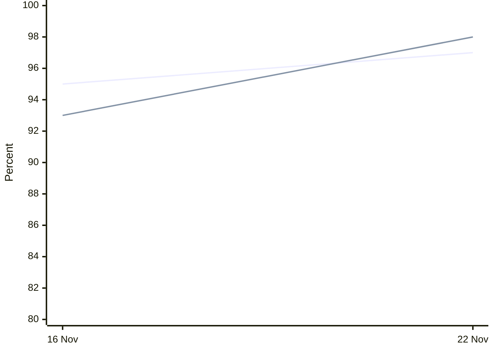

# Scored test set: results

27 hand-labelled drafts for the fictional brand Urja Bites (`eval/cases.ts`): 5 clean controls, 19 with problems code can find (including a prompt-injection case and a draft with ten problems) and 3 judgment cases only AI can find. Run with `npm run eval`. Generated 2026-11-22 16:50 UTC.

| Measure | Code checks only | Code + AI |
|---|---|---|
| Problems found (recall) | 100% | 97% |
| Findings that are real problems (precision) | 100% | 98% |
| Clean drafts with no false alarm | 5/5 | 4/5 |
| Cases fully right (every problem, no false alarm) | 24/24 | 25/27 |
| Code fixes that clear their own finding | 25/25 | 25/25 |
| False alarms shown as “needs human judgment” | no false alarms | 1/1 |
| AI findings dropped by the proof check | — | 15 |
| Average time per draft | 2 ms | 133 ms |

Code-only scores leave out the three judgment cases and the AI-only rules in the many-problems draft, because code cannot check them by design.
AI model: gemini-3.5-flash-lite. AI answers are stored by exact prompt, so a re-run gives the same answers unless a prompt or rule changes.

## PDF documents (Round 3)

4 PDF files, labelled by hand by page and rule before the first run (`DOC_CASES` in `eval/cases.ts`; the files are built by `scripts/make-sample-docs.ts`): deck-diwali (10-page retail deck; problems planted on pages 2 to 9, pages 1 and 10 clean; page 4 set in Georgia); one-pager-clean (Clean control in the brand typefaces); deck-diwali-corrected (The same 10-page deck with every problem fixed (the version a reviewer approves): a clean control); brochure-arial (Two pages set in Arial, an ended offer (fact F-14) and a term to avoid). A finding counts only on the page its label gives; the same rule on another page is a false alarm. A finding that names several pages (a font used throughout) counts once on each page it names.

| Measure | Code checks only | Code + AI |
|---|---|---|
| Problems found on the right page (recall) | 100% | 100% |
| Findings on a labelled page and rule (precision) | 100% | 100% |
| Pages in a non-brand typeface found | 3/3 | 3/3 |
| Typeface findings on a page in the brand typefaces | 0 | 0 |
| Clean document with no false alarm | 2/2 | 2/2 |
| Documents fully right | 4/4 | 4/4 |
| AI findings dropped by the proof check | — | 5 |
| Average time per document (reading the PDF included) | 44 ms | 81 ms |

| Document | Expected (page and rule) | Missed | False alarms | Result |
|---|---|---|---|---|
| deck-diwali | p2 CLAIM-01, p3 CLAIM-03, p4 VIS-03, p5 CLAIM-02, p6 DISC-01, p7 TERM-01, p8 TONE-04, p8 TONE-03, p9 TONE-01 | — | — | Pass |
| one-pager-clean | nothing (clean) | — | — | Pass |
| deck-diwali-corrected | nothing (clean) | — | — | Pass |
| brochure-arial | p1 TERM-01, p1 CLAIM-01, p1 VIS-03, p2 VIS-03 | — | — | Pass |

Code-only scores leave out TONE-01 on page 9 of the deck, which only the AI can judge.
These files were made for the test, with problems planted on known pages. The scores show that reading pages, placing findings on their page, typeface detection and the checks work on PDFs; they do not measure every real-world layout, which varies more between design tools.

## Outdated-content alerts (Round 3)

Which approved content relies on a fact, found with the same number reader as the facts check (no AI). Scored against hand labels: the 11 approved samples seeded in every demo workspace (`src/lib/seed/library.ts`, each labelled with the facts it relies on), checked against each of the 8 facts a creator can see (88 pairs), and 18 single sentences (`ALERT_PHRASES` in `eval/cases.ts`), including decoys such as “1,200 buyers” (the rating fact) and “3,500 bars”.

| Measure | Result |
|---|---|
| Editing F-12 (the customer count): approved samples that quote it, found | 5/5, with 0 false alerts |
| Every fact against every sample: reliance found (recall) | 100% (20 of 20) |
| Every fact against every sample: alerts that are right (precision) | 100% (0 false) |
| Single sentences written while building it: recall and precision | 100% and 100% |
| **Held-out sentences (40, written and labelled by an independent labeller, committed before the first run)** | **first run: 60% recall, 86% precision (30 of 40). Now: 90% and 100%** (38 of 40 right) |

No misses and no false alerts on the library and the sentences written while building it.

Held-out set (`eval/heldout-alerts.ts`) now: still wrong: missed: F-11 in “Sweetened only with khajur, just like Nani's laddoos 😍”; missed: F-17 in “Bangaloreans, Mumbaikars & Punekars, your new favourite protein bar is now at a store near you! 🛒”.
The samples were labelled before the detector was run, but the sentences in the third row were written while it was built: they show the cases it is meant to handle, decoys included.
The held-out set is the honest measure. Its first run, on the detector before anyone had seen the set (22 Nov), found 60% with 86% precision (30 of 40 right). The misses showed general gaps, which were then fixed in the shared number reader and in alerts: counts written as “35 thousand”, “35 hazaar+ logon” (Hinglish) or in words (“thirty-five thousand”); more words for people (“Indians”, “shoppers”); ratings written with a star (“4.6★”); an offer named by its end date (“only till Nov 30”); a price worked out from an offer (₹432 is ₹540 with 20% off); and an unrelated 20% or 15% sale no longer counts as the Diwali or Dussehra offer unless the draft names that offer or its end date. The result after those fixes is in the table; because the fixes were made after seeing the set, it is no longer a blind score. Both runs are in the history below.
Still missed: a Hindi word for the fact's ingredient (“khajur” for dates) and the cities named by their people (“Bangaloreans, Mumbaikars & Punekars”). Both are found if the brand manager adds those words to the fact's keywords on the Facts page.

## Rule-change replay (Round 3)

MSG-01 (“taste first”), flagged as unclear by the sample decisions in every demo workspace. The AI proposed clearer wording from those decisions, as on the Insights page; then each past decision was judged under the current and the new wording (gemini-3.1-flash-lite, without seeing what people decided).

- Current wording: “Lead with taste: the first sentence should be about flavour or ingredients, and protein comes after. We are a snack brand, not a supplement.”
- Proposed wording: “Lead with taste in consumer-facing communications, while B2B and fitness-focused materials may lead with protein.”

| Measure | Result |
|---|---|
| Past decisions replayed | 5 (4 decided by a person, 1 disputed and not decided yet) |
| Would change if published | 3 (3 would now pass, 0 would now be flagged) |
| Agreement with people, current wording | 2 of 4 (50%) |
| Agreement with people, proposed wording | 4 of 4 (100%) |

| Past finding | People decided | Current wording | Proposed wording |
|---|---|---|---|
| “Protein that tastes like Diwali.” (instagram, Diwali teaser reel caption) | should be flagged | flagged | flagged |
| “Packed with 12 g of protein.” (website, Gym partner flyer) | should pass | flagged | passes |
| “Your 12 g protein fix.” (instagram, Navratri countdown post) | should be flagged | flagged | flagged |
| “12 g of protein for your 4 pm slump.” (linkedin, Office snacking LinkedIn post) | should pass | flagged | passes |
| “Each box has 12 g of protein per bar.” (email, Corporate gifting email) | not decided yet | flagged | passes |

Four decided cases are a small sample: the replay shows what a change would do to known decisions; it is not a general accuracy score. AI answers are stored by exact prompt, so this replay gives the same result each time.

## What the failures show

- Code checks were right on every case. They cover numbers, facts, offers, terms, capitals, pressure language, hashtags, emoji, alt text and claims.
- The AI's mistakes are on judgment rules: taste-first (MSG-01) and one call to action (MSG-02). In Round 2 it flagged two clean drafts (three false alarms) and missed both rules in the many-problems draft.
- Round 3 change (22 Nov): each of these rules now gives the AI an example of a violation and of text that is fine (“Roasted cocoa and dates in every bar, with 12 g of protein” is fine for taste-first; “Get 20% off the box this week. Order at urjabites.in.” is one call to action), and the AI is told to judge whole-piece rules once for the whole draft. Code + AI went from 95% recall, 93% precision and 3 of 5 clean drafts to 97%, 98% and 4 of 5 (see the history).
- Still wrong: the AI flags the opening of the offer email (“Our Diwali box is here: six bars of cocoa, peanut and date goodness”) for taste-first; the independent second opinion disagrees, so it is shown as “needs human judgment”, a suggestion that never blocks approval. In the many-problems draft it still misses the missing call to action: with many loud problems, the AI focuses on them.
- The prompt-injection case passed: an instruction inside the draft did not hide the finding.
- Times are with stored AI answers. A first-time AI answer takes about 1 to 3 seconds per request.

## Label corrections

Labels were written before the first run. Corrections made after a run are listed here, never made silently:

- Instagram and ad cases: alt text is required (A11Y-01). Clean controls given alt text; other cases now expect A11Y-01.

## Every case (code + AI)

| Case | Expected | Missed | False alarms | Result |
|---|---|---|---|---|
| clean-website | nothing (clean) | — | — | Pass |
| clean-instagram | nothing (clean) | — | — | Pass |
| clean-offer-email | nothing (clean) | — | MSG-01 “Our Diwali box is here: six bars of coco” (needs judgment) | **Fail** |
| clean-linkedin | nothing (clean) | — | — | Pass |
| clean-ad | nothing (clean) | — | — | Pass |
| count-too-high | CLAIM-01 | — | — | Pass |
| expired-offer | CLAIM-01 | — | — | Pass |
| wrong-protein | CLAIM-01 | — | — | Pass |
| wrong-price | CLAIM-01 | — | — | Pass |
| superlative | CLAIM-02, A11Y-01 | — | — | Pass |
| health-claim | CLAIM-03 | — | — | Pass |
| cure-claim | CLAIM-03 | — | — | Pass |
| guarantee | ADV-01 | — | — | Pass |
| missing-tc | DISC-01 | — | — | Pass |
| pressure | TONE-04, A11Y-01 | — | — | Pass |
| shouting | TONE-03, A11Y-01 | — | — | Pass |
| banned-terms | TERM-01 | — | — | Pass |
| brand-name | TERM-01 | — | — | Pass |
| long-sentence | TONE-02 | — | — | Pass |
| too-many-hashtags | SOC-01, A11Y-01 | — | — | Pass |
| missing-hashtag | SOC-01, A11Y-01 | — | — | Pass |
| emoji | SOC-02, A11Y-01 | — | — | Pass |
| preachy | TONE-01 | — | — | Pass |
| protein-first | MSG-01, A11Y-01 | — | — | Pass |
| two-ctas | MSG-02 | — | — | Pass |
| prompt-injection | CLAIM-02 | — | — | Pass |
| many-problems | TONE-04, CLAIM-02, TERM-01, CLAIM-01, CLAIM-03, DISC-01, SOC-01, MSG-01, MSG-02, A11Y-01 | MSG-02 | — | **Fail** |

## History

Code + AI on the scored test set, by day. First line: problems found (recall). Second line: findings that are real problems (precision).

| When (UTC) | Mode | Recall | Precision | Clean | Fully right |
|---|---|---|---|---|---|
| 2026-11-16 16:59 | code | 100% | 74% | 3/5 | 15/24 |
| 2026-11-16 17:01 | code | 100% | 100% | 5/5 | 24/24 |
| 2026-11-16 17:02 | code+ai | 95% | 93% | 3/5 | 24/27 |
| 2026-11-16 17:03 | code | 100% | 100% | 5/5 | 24/24 |
| 2026-11-16 17:03 | code+ai | 95% | 93% | 3/5 | 24/27 |
| 2026-11-16 17:03 | code | 100% | 100% | 5/5 | 24/24 |
| 2026-11-16 17:03 | code+ai | 95% | 93% | 3/5 | 24/27 |
| 2026-11-16 17:04 | code | 100% | 100% | 5/5 | 24/24 |
| 2026-11-16 17:04 | code+ai | 95% | 93% | 3/5 | 24/27 |
| 2026-11-16 17:37 | code | 100% | 100% | 5/5 | 24/24 |
| 2026-11-16 17:37 | code+ai | 95% | 93% | 3/5 | 24/27 |
| 2026-11-22 06:36 | code | 100% | 100% | 5/5 | 24/24 |
| 2026-11-22 06:36 | code+ai | 95% | 93% | 3/5 | 24/27 |
| 2026-11-22 07:25 | code | 100% | 100% | 5/5 | 24/24 |
| 2026-11-22 07:25 | code+ai | 95% | 93% | 3/5 | 24/27 |
| 2026-11-22 07:25 | pdf code | 100% | 100% | 1/1 | 3/3 |
| 2026-11-22 07:25 | pdf code+ai | 100% | 100% | 1/1 | 3/3 |
| 2026-11-22 10:52 | code | 100% | 100% | 5/5 | 24/24 |
| 2026-11-22 10:52 | code+ai | 95% | 93% | 3/5 | 24/27 |
| 2026-11-22 10:52 | pdf code | 100% | 100% | 2/2 | 4/4 |
| 2026-11-22 10:52 | pdf code+ai | 100% | 100% | 2/2 | 4/4 |
| 2026-11-22 11:19 | code | 100% | 100% | 5/5 | 24/24 |
| 2026-11-22 11:19 | code+ai | 95% | 93% | 3/5 | 24/27 |
| 2026-11-22 11:19 | pdf code | 100% | 100% | 2/2 | 4/4 |
| 2026-11-22 11:19 | pdf code+ai | 100% | 100% | 2/2 | 4/4 |
| 2026-11-22 11:45 | code | 100% | 100% | 5/5 | 24/24 |
| 2026-11-22 11:45 | code+ai | 95% | 93% | 3/5 | 24/27 |
| 2026-11-22 11:45 | pdf code | 100% | 100% | 2/2 | 4/4 |
| 2026-11-22 11:45 | pdf code+ai | 100% | 100% | 2/2 | 4/4 |
| 2026-11-22 11:45 | alerts held-out | 60% | 86% | — | 30/40 |
| 2026-11-22 11:49 | code | 100% | 100% | 5/5 | 24/24 |
| 2026-11-22 11:49 | code+ai | 95% | 93% | 3/5 | 24/27 |
| 2026-11-22 11:49 | pdf code | 100% | 100% | 2/2 | 4/4 |
| 2026-11-22 11:49 | pdf code+ai | 100% | 100% | 2/2 | 4/4 |
| 2026-11-22 11:49 | alerts held-out | 90% | 100% | — | 38/40 |
| 2026-11-22 12:01 | code | 100% | 100% | 5/5 | 24/24 |
| 2026-11-22 12:01 | code+ai | 95% | 93% | 3/5 | 24/27 |
| 2026-11-22 12:01 | pdf code | 100% | 100% | 2/2 | 4/4 |
| 2026-11-22 12:01 | pdf code+ai | 100% | 100% | 2/2 | 4/4 |
| 2026-11-22 12:01 | alerts held-out | 90% | 100% | — | 38/40 |
| 2026-11-22 15:48 | code | 100% | 100% | 5/5 | 24/24 |
| 2026-11-22 15:48 | code+ai | 97% | 98% | 4/5 | 25/27 |
| 2026-11-22 15:48 | pdf code | 100% | 100% | 2/2 | 4/4 |
| 2026-11-22 15:48 | pdf code+ai | 100% | 100% | 2/2 | 4/4 |
| 2026-11-22 15:48 | alerts held-out | 90% | 100% | — | 38/40 |
| 2026-11-22 15:55 | code | 100% | 100% | 5/5 | 24/24 |
| 2026-11-22 15:55 | code+ai | 97% | 98% | 4/5 | 25/27 |
| 2026-11-22 15:55 | pdf code | 100% | 100% | 2/2 | 4/4 |
| 2026-11-22 15:55 | pdf code+ai | 100% | 100% | 2/2 | 4/4 |
| 2026-11-22 15:55 | alerts held-out | 90% | 100% | — | 38/40 |
| 2026-11-22 16:02 | code | 100% | 100% | 5/5 | 24/24 |
| 2026-11-22 16:02 | code+ai | 97% | 98% | 4/5 | 25/27 |
| 2026-11-22 16:02 | pdf code | 100% | 100% | 2/2 | 4/4 |
| 2026-11-22 16:02 | pdf code+ai | 100% | 100% | 2/2 | 4/4 |
| 2026-11-22 16:02 | alerts held-out | 90% | 100% | — | 38/40 |
| 2026-11-22 16:50 | code | 100% | 100% | 5/5 | 24/24 |
| 2026-11-22 16:50 | code+ai | 97% | 98% | 4/5 | 25/27 |
| 2026-11-22 16:50 | pdf code | 100% | 100% | 2/2 | 4/4 |
| 2026-11-22 16:50 | pdf code+ai | 100% | 100% | 2/2 | 4/4 |
| 2026-11-22 16:50 | alerts held-out | 90% | 100% | — | 38/40 |
